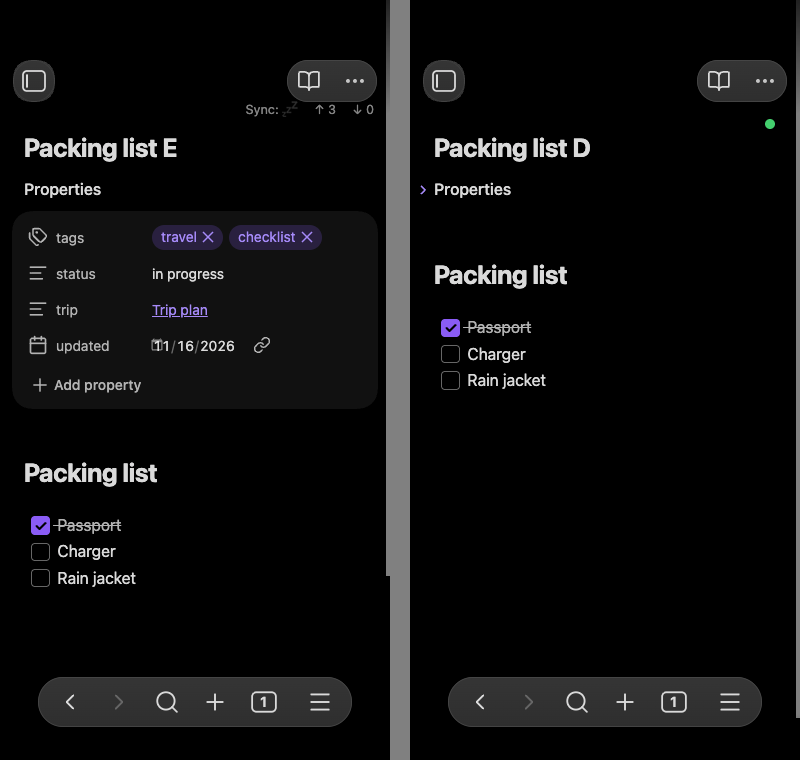
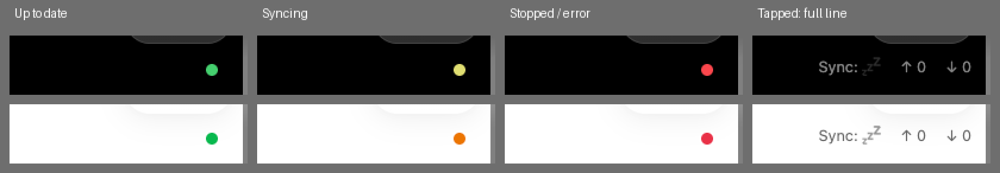

# Quiet UI

An Obsidian plugin that takes two distractions off the screen, on phone and desktop:

1. **Self-hosted LiveSync's status line becomes a dot.** The line in the top-right corner of the editor
   (`Sync: 💤 ↑ 21 ↓ 0`) shows as a small colored dot instead. Tap the dot to see the full line; tap the line
   to go back to the dot. The dot is the default, and each device remembers your choice.
2. **Properties open folded.** Every note opens with its Properties block folded to its header, so the note
   starts with its content. One tap on "Properties" opens them, exactly as Obsidian's own fold does.

Each one has its own switch in the plugin's settings; both are on by default.



## The dot



| Dot | Means |
|---|---|
| Green | Up to date: LiveSync is connected and idle (or, in the on-event and periodic modes, its last sync finished and nothing is waiting). |
| Amber | Syncing: LiveSync is transferring, comparing changes with the server, or has files or database entries waiting to be processed. |
| Red | Stopped or failing: LiveSync reported an error, or LiveSync mode is on and replication has ended. |

The color comes from LiveSync's own state, not from reading the emoji it prints: the replication status
(`syncStatus`) and the pending counters LiveSync keeps for files, database entries and conflicts. The dot
checks them once a second.

If LiveSync is not installed, not running, or a future version stores its state differently, the plugin
steps aside and LiveSync's own line shows exactly as LiveSync draws it.

On desktop, LiveSync's item in the status bar gets a dot too; tapping either one switches both.

## Properties folded

The plugin uses Obsidian's own fold, the one the triangle next to "Properties" toggles, so nothing is
hidden or restyled. It folds a note once, when the note opens; if you open the Properties, they stay open
while you work on that note. Notes without properties are left alone.

Obsidian remembers folds per note on each device, so a note you leave folded is remembered folded. That
memory is Obsidian's, and it stays if you turn the plugin off: a note then opens the way you last left it.

For comparison, Obsidian's built-in setting (Settings > Editor > Properties in document) offers:

- **Visible** (the default): the Properties block is shown at the top of the note, open unless you fold it.
- **Hidden**: no Properties block in the note at all; you edit properties in the Properties side panel.
- **Source**: the raw YAML front matter is shown as text at the top of the note.

Quiet UI keeps Visible and only folds the block, so properties stay one tap away in the note itself.

## Install

With [BRAT](https://github.com/TfTHacker/obsidian42-brat): *Add beta plugin* and enter `lpasqualis/obsidian-quiet-ui`,
then enable **Quiet UI** under Community plugins.

By hand: download `main.js`, `manifest.json` and `styles.css` from the
[latest release](https://github.com/lpasqualis/obsidian-quiet-ui/releases/latest) into
`<vault>/.obsidian/plugins/quiet-ui/` and enable the plugin.

## Compatibility

Built and tested with Obsidian 1.15.1 and Self-hosted LiveSync 1.0.50. Both features read parts of their
host that are not public API (LiveSync's internal services; Obsidian's Properties editor), and both fall
back to the stock behaviour when those parts are missing: LiveSync's line shows, and Properties open the
way Obsidian opens them.

## Build

```sh
npm install
npm run build
```

## License

MIT
